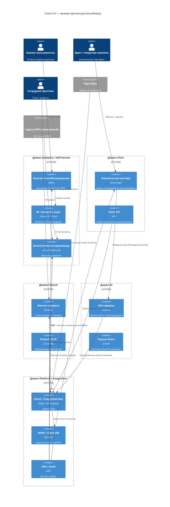

# Задание 1. Целевая архитектура (C4 Container) — через 1 год

## Диаграмма контейнеров (C4)

## Как Kafka + API Gateway закрывают функции ESB

Контейнер на диаграмме тот же (`Event / Integration Bus`). Внутри него функции Apache Camel разносятся так, без отдельного «ESB-монолита» и без переноса бизнес-логики в шину:

| Функция ESB | Чем закрывается |
|-------------|-----------------|
| Маршрутизация, синхронные API, auth, квоты | API Gateway |
| Асинхронные интеграции, pub/sub, CDC | Kafka |
| ФЛК | Контракт события (Schema Registry) + проверки в сервисе-источнике |
| Потоковые трансформации | Kafka Streams / Flink (нормализация, обогащение, отсечение медкарт) |
| Пакетные трансформации | Отдельные batch-джобы в витрины Lakehouse (не ночные маршруты в DWH) |
| Надёжность | Outbox, retry/DLQ, идемпотентные потребители, replay топика |
| Бизнес-логика и оркестрация продукта | Остаётся в доменах (Fintech, Clinic, AI), не в шине |

## Как архитектура поддерживает бизнес-сценарии

| Сценарий | Как поддерживается |
|----------|-------------------|
| Быстрая отчётность | Портал + semantic layer + витрины доменов в lakehouse; без тяжёлых ad-hoc трансформаций в монолитном DWH |
| Независимое развитие финтеха | Отдельный домен Fintech (сервисы + OLTP), публикация событий в шину, свои витрины |
| Независимое развитие ИИ | Закрытый контур Clinic↔AI; в аналитику только агрегаты/качество, не медкарты |
| Масштабирование новых бизнесов | Partners → Integration Bus → витрины; логика не пишется в старый DWH |
| Комплаенс | IAM/Audit + исключение медкарт/исследований из витрины |

См. также файл `c4_container_diagram.png` (упрощённая схема).
