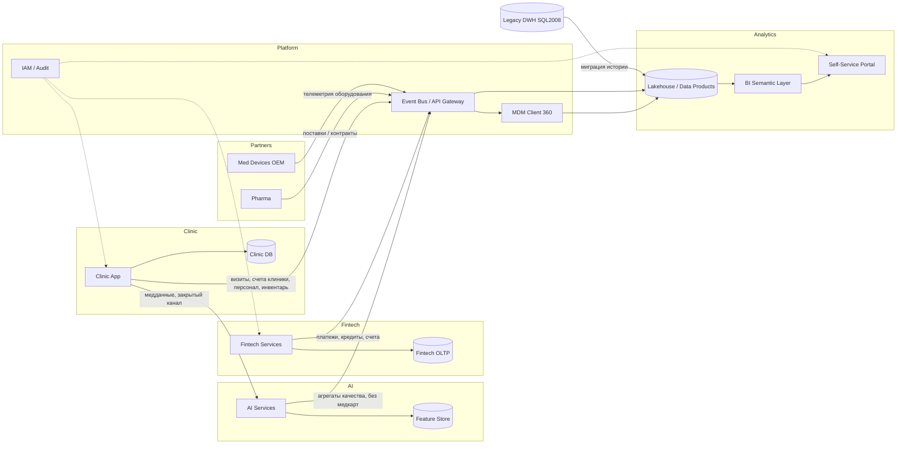

# Задание 2. Домены и потоки данных

## Разделение на домены

| Домен | Ответственность | Зачем нужен |
|-------|-----------------|-------------|
| **Clinic** | Клиники: приёмы, медкарты, исследования, персонал, инвентарь | Операционная медицина; медданные **не** идут в витрину |
| **Fintech** | Банк: счета, кредиты, платежи, фин. отчётность продукта | Независимое развитие под банковскую лицензию |
| **AI** | ИИ-сервисы над медданными | Отдельный контур, без публикации сырых медкарт в аналитику |
| **Analytics** | Портал самообслуживания, витрины KPI, semantic layer | Быстрые отчёты по разрешённым срезам |
| **Platform** | Интеграция (шина/события), MDM клиента, IAM, облачная платформа | Подключение доменов и партнёров без логики в DWH |
| **Partners** (будущий) | Фарма, электроника медоборудования | Масштабирование экосистемы как отдельных bounded contexts |

Обоснование: границы = бизнес-возможности и регуляторные контуры (медицина ≠ финансы ≠ аналитика). Логика продукта живёт в домене, в аналитику уходят только события/витрины.

## Data Flow Diagram

Файл: `dfd.png`

### Сценарии на потоках
- **Новый финтех-сервис**: сервис в Fintech → события в Bus → витрина Fintech в Lakehouse → отчёт в портале. DWH не меняем.
- **ИИ для медданных**: Clinic → AI (закрыто) → в Bus только агрегаты → Analytics. Медкарты в витрину не попадают.
- **Партнёр (фарма/электроника)**: Partners → Bus → свой data product в Analytics.

## Преимущества для бизнеса
- Быстрее вывод продуктов: команды доменов релизят независимо.
- Нет роста бизнес-логики в DWH: DWH → источник истории / на выводе.
- Отдельное развитие клиники, банка, ИИ и партнёров.
- Проще комплаенс: разные контуры доступа и аудита.
